<p align="center">
  <a href="https://github.com/MuhammadDan">
    
  </a>
</p>

<p align="center">
  <a href="https://www.linkedin.com/in/daniyal-khan-735a88262/"></a>
  <a href="https://inquisitive-khapse-bc923d.netlify.app/"></a>
  <a href="mailto:daniyalk154330@gmail.com"></a>
  <a href="https://github.com/MuhammadDan"></a>
</p>

<p align="center">
  
</p>

## 🍷 EXECUTIVE SUMMARY

I am a motivated **Full-Stack Software Developer** based in Karachi, Pakistan, specializing in architecting resilient web backends, type-safe APIs, and responsive cross-platform web and mobile experiences. 

My engineering background spans the TypeScript and JavaScript ecosystem (**Next.js**, **React**, **Node.js**, **Fastify**), mobile application development (**React Native**, native Android with **Kotlin**), and enterprise data and systems engineering (**PostgreSQL**, **PL/SQL**, **SQL Server**, and **Docker**). With professional experience across production environments at **FreshShifts** and **360XpertSolutions**, I focus on building reliable software with high availability, measurable performance optimizations, and clean architecture.

```text
┌────────────────────────────── SYSTEM SPECIFICATION ──────────────────────────────┐
│  • Primary Focus    : Full-Stack Engineering (Web & Mobile Applications)         │
│  • Core Languages   : TypeScript, JavaScript, Python, Java, Kotlin, SQL          │
│  • Architecture     : RESTful Services, Type-Safe APIs (tRPC), Containerization  │
│  • Status           : Open to impactful roles & high-performance engineering     │
└──────────────────────────────────────────────────────────────────────────────────┘
```

<p align="center">
  
</p>

## 💼 PROFESSIONAL EXPERIENCE

```
2025 ────────────────────────────── 2026 ────────────────────────────── PRESENT
  │                                   │
  ├─ Mobile App & Backend Developer   ├─ Backend Developer
  │  FreshShifts (Dec 2025 - Feb 2026)│  360XpertSolutions (Dec 2025 - Feb 2026)
  │  • React Native & Android Kotlin  │  • Fastify RESTful microservices (99.9% uptime)
  │  • Node.js / Express.js APIs      │  • Cross-functional API integration (-25% load times)
  │  • PL/SQL database optimization   │  • Automated test protocols (-30% bug reports)
  │  • Containerized Docker workflows │
```

### 🔹 Mobile App & Backend Developer — **FreshShifts**
*Dec 2025 – Feb 2026 · Karachi, Pakistan*
- Engineered and maintained cross-platform mobile applications using **React Native** alongside native Android modules built in **Kotlin**.
- Designed and integrated scalable **RESTful APIs** and backend microservices using **Node.js** and **Express.js** to power core mobile features.
- Optimized database queries, stored routines, and data management pipelines utilizing **PL/SQL** for reliable background performance.
- Managed containerized development environments and service deployments with **Docker**, facilitating seamless collaboration across frontend and backend units.

### 🔹 Backend Developer — **360XpertSolutions**
*Dec 2025 – Feb 2026 · Karachi, Pakistan*
- Developed and maintained high-throughput backend services for client web applications with **Fastify**, sustaining **99.9% uptime** in production.
- Partnered closely with frontend engineering teams to integrate REST APIs, reducing page load times by **25%** across core user workflows.
- Instituted automated testing protocols for backend business logic, reducing post-deployment defect reports by **30%** and accelerating release cadences.

<p align="center">
  
</p>

## 🚀 FEATURED PROJECTS

<table>
  <tr>
    <td width="50%" valign="top">
      <h3>🤖 AI-Powered Blogging Platform</h3>
      <p>
        An intelligent, full-stack content publishing and monetization engine built with <b>Next.js</b>, <b>Fastify</b>, <b>PostgreSQL</b>, <b>OpenAI API</b>, and <b>Stripe</b>.
      </p>
      <ul>
        <li><b>AI Generation:</b> Auto and custom prompt-driven article authoring via OpenAI.</li>
        <li><b>Security & RBAC:</b> OTP-based authentication and role-based access for creators and administrators.</li>
        <li><b>Monetization:</b> Integrated Stripe subscription workflows and member tiers.</li>
        <li><b>Dashboards:</b> Dedicated moderation, content management, and revenue analytics panels.</li>
      </ul>
      <p>
        <a href="https://github.com/MuhammadDan"></a>
      </p>
    </td>
    <td width="50%" valign="top">
      <h3>📚 Full-Stack Course Management Platform</h3>
      <p>
        A scalable education management system engineered with <b>Next.js (App Router)</b>, <b>TypeScript</b>, <b>Supabase</b>, and <b>tRPC</b>.
      </p>
      <ul>
        <li><b>Type-Safe Architecture:</b> End-to-end type safety connecting client interfaces directly to database queries.</li>
        <li><b>Scale:</b> Engineered to manage course workflows and assignments for <b>500+ active users</b>.</li>
        <li><b>Access Control:</b> Multi-role permission model distinguishing students, instructors, and staff.</li>
        <li><b>Backend:</b> Real-time database synchronizations and session management via Supabase.</li>
      </ul>
      <p>
        <a href="https://github.com/MuhammadDan"></a>
      </p>
    </td>
  </tr>
  <tr>
    <td width="50%" valign="top">
      <h3>🏥 HomeCare — Appointment & Notification Engine</h3>
      <p>
        A distributed appointment management and alert dispatch service built using <b>Node.js</b>, <b>PL/SQL</b>, and <b>Docker</b>.
      </p>
      <ul>
        <li><b>Event Notifications:</b> Real-time multi-channel alerts (Email &amp; WhatsApp) triggered on appointment creation, rescheduling, or cancellation.</li>
        <li><b>Reliability:</b> Robust transactional handling and query optimization in PL/SQL.</li>
        <li><b>Infrastructure:</b> Fully containerized multi-container setup configured with Docker.</li>
      </ul>
      <p>
        <a href="https://github.com/MuhammadDan"></a>
      </p>
    </td>
    <td width="50%" valign="top">
      <h3>⌚ Handwatch Luxury E-Commerce Platform</h3>
      <p>
        Full-stack modern retail application built with <b>React</b>, <b>ASP.NET Core Web API</b>, and <b>Microsoft SQL Server</b>.
      </p>
      <ul>
        <li><b>Authentication:</b> Stateless JWT token authentication with role-based access control.</li>
        <li><b>Storefront Logic:</b> Dynamic product CRUD, cart state management, and server-side pagination.</li>
        <li><b>Architecture:</b> Decoupled RESTful API backend serving an optimized, responsive client interface.</li>
      </ul>
      <p>
        <a href="https://github.com/MuhammadDan"></a>
      </p>
    </td>
  </tr>
  <tr>
    <td width="50%" valign="top">
      <h3>✈️ Flight Booking Application</h3>
      <p>
        Full-stack flight scheduling and reservation platform utilizing <b>React.js</b>, <b>Tailwind CSS</b>, and <b>SQL</b>.
      </p>
      <ul>
        <li><b>Real-Time Discovery:</b> Dynamic flight lookup, multi-parameter filtering, and live schedule views.</li>
        <li><b>Booking Flow:</b> Seat reservation pipelines, customer profile sync, and persistent SQL transactions.</li>
        <li><b>Interface:</b> High-contrast responsive design optimized across desktop and mobile devices.</li>
      </ul>
      <p>
        <a href="https://github.com/MuhammadDan"></a>
      </p>
    </td>
    <td width="50%" valign="top">
      <h3>📊 Employee Management Dashboard</h3>
      <p>
        Internal enterprise operations tracking application built with <b>React.js</b> and <b>Tailwind CSS</b>.
      </p>
      <ul>
        <li><b>State Architecture:</b> Centralized reactive state orchestration using React's <code>useContext</code> hook.</li>
        <li><b>Analytics:</b> Visual monthly performance charts and staff KPI metrics monitoring.</li>
        <li><b>Workflow:</b> Personnel records CRUD operations and productivity tracking.</li>
      </ul>
      <p>
        <a href="https://github.com/MuhammadDan"></a>
      </p>
    </td>
  </tr>
</table>

<p align="center">
  
</p>

## 🛠️ TECHNICAL ARSENAL

### 💻 Programming Languages
<p>
  
  
  
  
  
  
  
  
</p>

### 🌐 Frontend & Mobile Architecture
<p>
  
  
  
  
  
</p>

### ⚙️ Backend, APIs & Distributed Services
<p>
  
  
  
  
  
  
  
  
</p>

### 🗄️ Database Systems & Storage
<p>
  
  
  
  
  
</p>

### 🛠️ DevOps, Cloud & AI Tooling
<p>
  
  
  
  
  
  
  
  
</p>

<p align="center">
  
</p>

## 🎓 EDUCATION & CREDENTIALS

### 🏛️ Verified Education
- 🎓 **Bachelor of Science in Computer Science (BSCS)**
  *University of Karachi · Karachi, Pakistan* · **2021 – 2025**
- 📐 **Intermediate in Pre-Engineering (HSC)**
  *Govt Delhi Inter Science College · Karachi, Pakistan* · **2019 – 2021**
- 🔬 **Matriculation in Science Group**
  *Programmer School (Karachi Board) · Karachi, Pakistan* · **2018 – 2019**

### 📜 Verified Certifications & Courses
- 🏆 **JavaScript Specialization** — Coursera · [Verify Credential](https://coursera.org/share/568ba299c2c209447f8c903df67e8df8)
- 🏆 **Legacy JavaScript Algorithms and Data Structures** — freeCodeCamp · [Verify Credential](https://www.freecodecamp.org/certification/daniyalkhan23456/javascript-algorithms-and-data-structures)
- 🏆 **React (Basic)** — HackerRank · [Verify Credential](https://www.hackerrank.com/certificates/5c621c8f629a)
- 🏆 **Next.js** — Udemy · [Verify Credential](https://www.udemy.com/certificate/UC-718f7d39-ed1e-44cb-957f-df059e460fe1/)
- 🏆 **Introduction to ASP.NET** — Simplilearn
- 🏆 **Web and App Development** — Saylani Mass IT Training (SMIT) · [Verify Credential](https://www.saylaniwelfare.com/)
- 🏆 **Master Course in ChatGPT** — Udemy · [Verify Credential](https://www.udemy.com/certificate/UC-0822e7ac-646d-4dc9-a000-4e78bfa6905f/)

<p align="center">
  
</p>

## 📊 GITHUB ACTIVITY & METRICS

<p align="center">
  <a href="https://github.com/MuhammadDan">
    
  </a>
</p>

<div align="center">
  <p>
    <a href="https://github.com/MuhammadDan">
      
    </a>
    <a href="https://github.com/MuhammadDan">
      
    </a>
  </p>
  <p>
    <a href="https://github.com/MuhammadDan?tab=repositories">
      
    </a>
    <a href="https://github.com/MuhammadDan?tab=overview">
      
    </a>
  </p>
</div>

<p align="center">
  
</p>

## 🌐 CONNECT & PROFESSIONAL NETWORKS

<div align="center">
  <table style="border: none;">
    <tr>
      <td align="center">
        <a href="https://www.linkedin.com/in/daniyal-khan-735a88262/">
          
        </a>
      </td>
      <td align="center">
        <a href="https://inquisitive-khapse-bc923d.netlify.app/">
          
        </a>
      </td>
    </tr>
    <tr>
      <td align="center">
        <a href="mailto:daniyalk154330@gmail.com">
          
        </a>
      </td>
      <td align="center">
        <a href="https://github.com/MuhammadDan">
          
        </a>
      </td>
    </tr>
  </table>
</div>

<p align="center">
  <br />
  
</p>
