<table width="100%" bgcolor="#10070C" border="0" cellpadding="0" cellspacing="0" style="background-color: #10070C; width: 100%; border-collapse: collapse; border-spacing: 0; margin: 0; padding: 0; border: none;">
  <tr bgcolor="#10070C" style="background-color: #10070C; border: none; margin: 0; padding: 0;">
    <td align="center" bgcolor="#10070C" style="background-color: #10070C; padding: 0; margin: 0; border: none;">
      <!-- 00: HERO BANNER -->
      

        
      

      <!-- VERIFIED QUICK NAVIGATION HUB -->
      

        
        
        
        
        
      

      <!-- DIVIDER -->
      

        
      

      <!-- 01: EXECUTIVE SUMMARY -->
      

        
      

      <!-- DIVIDER -->
      

        
      

      <!-- 02: PROFESSIONAL EXPERIENCE -->
      

        
      

      <!-- DIVIDER -->
      

        
      

      <!-- 03: FEATURED ENGINEERING PROJECTS -->
      

        
      

      <!-- PROJECT CODEBASE LINKS -->
      

        
        
        
        
        
        
      

      <!-- DIVIDER -->
      

        
      

      <!-- 04: TECHNICAL ARSENAL -->
      

        
      

      <!-- DIVIDER -->
      

        
      

      <!-- 05: EDUCATION & CERTIFICATIONS -->
      

        
      

      <!-- VERIFIED CREDENTIAL VERIFICATION LINKS -->
      

        
        
        
        
        
        
      

      <!-- DIVIDER -->
      

        
      

      <!-- 06: GITHUB ACTIVITY & METRICS -->
      

        
      

      <!-- LIVE GITHUB STATS TELEMETRY -->
      

        
        
      

      

        
        
      

      <!-- DIVIDER -->
      

        
      

      <!-- 07: VERIFIED PROFILE CONNECT HUB -->
      

        
        
        
        
      

      <!-- 08: FOOTER -->
      

        
      

    </td>
  </tr>
</table>
